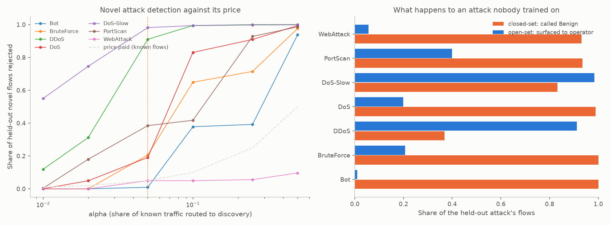

# Open-set recognition and unknown-family discovery

The classifiers in this project are closed-set: `predict_proba` is a distribution
over the eight classes the training data contained, so every flow is forced into
one of them. This layer adds the verdict they cannot produce, "none of these",
and names what it finds. Generated by `python -m src.cli openset-eval`.

- Non-conformity score: **knn**, k = 10 neighbours
- Conformal significance level: **alpha = 0.05**
- Feature set: **full** (329,392 test flows)

## 1. Is the test honest? Conformal validity on known classes

Every flow in the test split belongs to a class the recogniser was fitted on, so
anything it rejects is pure cost. The conformal construction promises that share
is alpha, and alpha is therefore a known price rather than a tuned threshold.

| Score | Rejection rate on known flows | Promised (alpha) | Within bound |
|---|---|---|---|
| knn | 0.0468 | 0.05 | yes |
| gaussian | 0.0461 | 0.05 | yes |

Per class, for the selected score:

| Class | Rejected |
|---|---|
| Benign | 0.0495 |
| Bot | 0.0000 |
| BruteForce | 0.0015 |
| DDoS | 0.0439 |
| DoS | 0.0248 |
| DoS-Slow | 0.0585 |
| PortScan | 0.0432 |
| WebAttack | 0.0062 |

## 2. Zero-day detection: leave one class out

Each row is a separate experiment in which that attack class is removed from
the training data, from the feature scaling and from the open-set calibration,
then its test flows are replayed. Nothing in the fold has ever seen it, so it
stands in for a genuinely novel attack.

- **AUC** is the probability that a novel flow is ranked more anomalous than a
  known one. It does not depend on where the threshold is put.
- **Closed-set -> Benign** is the share the Random Forest calls Benign, which is
  the silent failure this layer exists to remove.
- **Surfaced** is the share an operator would see at all: rejected as unknown, or
  flagged as some attack class, right name or wrong.
- **Silent** is its complement, the share of the attack nobody would ever see. The
  before figure counts everything the classifier did not flag, not only what it called
  Benign, because a flow predicted as an attack below the alert confidence is just as
  invisible. The two columns are therefore directly comparable.

| Held out | Test flows | AUC | Unknown (open-set) | Closed-set -> Benign | Surfaced | Silent before | Silent after | Known rejected |
|---|---|---|---|---|---|---|---|---|
| Bot | 209 | 0.760 | 0.010 | 1.000 | 0.010 | 1.000 | 0.990 | 0.0461 |
| BruteForce | 1,373 | 0.866 | 0.206 | 1.000 | 0.206 | 1.000 | 0.794 | 0.0406 |
| DDoS | 19,201 | 0.966 | 0.910 | 0.369 | 0.912 | 0.550 | 0.088 | 0.0511 |
| DoS | 27,445 | 0.906 | 0.191 | 0.989 | 0.199 | 0.992 | 0.801 | 0.0481 |
| DoS-Slow | 1,590 | 0.984 | 0.982 | 0.832 | 0.984 | 0.835 | 0.016 | 0.0472 |
| PortScan | 278 | 0.871 | 0.385 | 0.935 | 0.399 | 0.950 | 0.601 | 0.0458 |
| WebAttack | 321 | 0.149 | 0.050 | 0.931 | 0.056 | 0.994 | 0.944 | 0.0470 |
| **mean** | | **0.786** | **0.390** | **0.865** | **0.395** | **0.903** | **0.605** | **0.0466** |

### The operating curve

alpha is a dial, so the honest result is the curve rather than one point on it.
Averaged over the folds:

| alpha | Novel flows rejected | Known flows rejected |
|---|---|---|
| 0.01 | 0.096 | 0.008 |
| 0.02 | 0.184 | 0.018 |
| 0.05 | 0.390 | 0.047 |
| 0.1 | 0.616 | 0.095 |
| 0.25 | 0.714 | 0.246 |
| 0.5 | 0.855 | 0.496 |

The known-rejection column tracking alpha to three decimals is the conformal
guarantee holding in practice. The cost of a loose alpha is bounded and known
in advance, which is why this layer can afford one: a rejected flow raises no
alert by itself, it only enters the clusterer below.

## 3. Are the discovered families real?

The same folds, with the held-out class mixed back into ordinary traffic and the
whole mixture replayed through the open-set test and the clusterer in arrival
order. Ground truth is the true class of every flow the clusterer was handed,
which it never sees.

- A family becomes reportable at 50 flows.
- Known traffic mixed in per fold: 30,000 flows.

| Held out | Rejected | of those novel | Families | Reportable | Purity (class / tool) | ARI (class / tool) | Recall into one family | That family's precision | Flows to discovery | Reportable, ordinary traffic |
|---|---|---|---|---|---|---|---|---|---|---|
| Bot | 1,395 | 2 | 226 | 2 | 0.996 / 0.996 | 0.007 / 0.007 | 1.000 | 0.667 | n/a | 2 |
| BruteForce | 1,540 | 283 | 188 | 3 | 0.991 / 0.990 | 0.042 / 0.041 | 0.975 | 1.000 | 268 | 2 |
| DDoS | 18,875 | 17,479 | 237 | 9 | 0.998 / 0.998 | 0.111 / 0.111 | 0.494 | 1.000 | 111 | 2 |
| DoS | 6,771 | 5,241 | 296 | 14 | 0.997 / 0.997 | 0.205 / 0.286 | 0.504 | 1.000 | 108 | 5 |
| DoS-Slow | 3,002 | 1,561 | 252 | 10 | 0.983 / 0.943 | 0.103 / 0.153 | 0.266 | 0.977 | 342 | 2 |
| PortScan | 1,520 | 107 | 236 | 2 | 0.976 / 0.976 | 0.009 / 0.009 | 0.411 | 0.721 | 1307 | 1 |
| WebAttack | 1,403 | 16 | 235 | 2 | 0.996 / 0.994 | 0.007 / 0.006 | 1.000 | 1.000 | n/a | 2 |
| **mean** | | | | | **0.991 / 0.985** | **0.069 / 0.088** | **0.664** | **0.909** | **268** | **16 total** |

**Recall into one family** is the share of the rejected novel flows that landed in
the single family that best represents the attack, and **precision** is the share of
that family's members that really were the novel attack. Recall below 1 is not
necessarily a failure: three of the eight classes are unions of two attack tools
(BruteForce is ftp-patator and ssh-patator, DoS is hulk and goldeneye, DoS-Slow is
slowloris and slowhttptest), so splitting one class into several pure families is the
clusterer making a distinction the label map erased. That is why purity and the
adjusted Rand index are reported against the fine-grained tool labels as well.
**Reportable families made of ordinary traffic** are families large enough to report
whose members are mostly not the held-out attack. **Flows to discovery** is how many
rejected flows had arrived before the attack's family became reportable.

The novel family was reported in 5 of 7 folds. This is the number that matters operationally, and
it is higher than the per-flow unknown rate in section 2 would suggest: an attack
produces many flows and a family needs only a few of them, so a per-flow rate of 0.2
still means the attack is found.

### Choosing the reporting threshold

A family is reported once it holds this many flows. The threshold is read off
this curve rather than argued for, and the curve is what an earlier design got
wrong: requiring a number of flows rejected at a stricter conformal level
reported the novel family in 1 fold of 7 while still admitting 164 families of
ordinary traffic. The p-value cannot do this job, because the routing level has
already conditioned on it. Among flows that reached the clusterer, a rejected
benign flow and a rejected novel flow have p-values drawn from much the same
range, so the p-value adds little. Size does.

| Flows to report | Novel family found | Families of ordinary traffic | Families reported in total |
|---|---|---|---|
| 3 | 7 of 7 | 767 | 824 |
| 5 | 6 of 7 | 548 | 599 |
| 10 | 6 of 7 | 277 | 319 |
| 15 | 6 of 7 | 167 | 206 |
| 20 | 5 of 7 | 112 | 146 |
| 30 | 5 of 7 | 67 | 99 |
| 50 **(default)** | 5 of 7 | 16 | 42 |
| 100 | 4 of 7 | 0 | 21 |

The families of ordinary traffic are not errors in the way a misclassification
is. They are patterns the deployment has and the training data did not describe,
unusual in the same way every time, which is why they cluster at all. An operator
names such a family once and it stops being an unexplained alert. That is the
ordinary baselining cost of any anomaly detector, and the column above measures
it rather than estimating it.

What the operator reads, taken verbatim from the clusterer:

- *Bot held out*: `NETRA-U200: 3 unrecognised flows from 3 sources. Total Length of Fwd Packets=134342 (3.6 above benign), Subflow Fwd Bytes=134342 (3.6 above benign), Avg Fwd Segment Size=4071 (3.5 above benign), Fwd Packet Length Mean=4071 (3.5 above benign). nearest known class Benign (p=0.022)`
- *BruteForce held out*: `NETRA-U001: 276 unrecognised flows from 1 source. Bwd Packets/s=5208 (1.5 above benign), Fwd Packets/s=10417 (1.4 above benign), Avg Bwd Segment Size=0.0 (1.4 below benign), Bwd Packet Length Mean=0.0 (1.4 below benign). nearest known class Benign (p=0.035)`
- *DDoS held out*: `NETRA-U002: 8642 unrecognised flows from 1 source. Bwd Packet Length Std=2177 (1.8 above benign), Down/Up Ratio=2.0 (1.7 above benign), Packet Length Variance=3625074 (1.6 above benign), Packet Length Std=1904 (1.6 above benign). nearest known class Benign (p=0.026)`
- *DoS held out*: `NETRA-U001: 2639 unrecognised flows from 1 source. Idle Min=100000000 (2.2 above benign), Idle Mean=100000000 (2.2 above benign), Idle Max=100000000 (2.1 above benign), Fwd IAT Std=40900000 (1.9 above benign). nearest known class Benign (p=0.022)`
- *DoS-Slow held out*: `NETRA-U007: 426 unrecognised flows from 5 sources. Idle Std=12200000 (4.0 above benign), Active Min=7013603 (3.0 above benign), Fwd IAT Min=997691 (3.0 above benign), Active Mean=7013603 (2.9 above benign). nearest known class Bot (p=0.010)`
- *PortScan held out*: `NETRA-U013: 61 unrecognised flows from 9 sources. Avg Fwd Segment Size=0.0 (2.4 below benign), Fwd Packet Length Mean=0.0 (2.4 below benign), Subflow Fwd Bytes=0.0 (2.2 below benign), Total Length of Fwd Packets=0.0 (2.2 below benign). nearest known class Benign (p=0.020)`
- *WebAttack held out*: `NETRA-U083: 16 unrecognised flows from 1 source. Total Fwd Packets=203.0 (5.2 above benign), Subflow Fwd Packets=203.0 (5.2 above benign), act_data_pkt_fwd=101.0 (4.8 above benign), Fwd Header Length=6504 (4.6 above benign). nearest known class Benign (p=0.031)`

## 4. Domain shift: a network the models were never trained on

The same test over 500,000 UNSW-NB15 flows. This is not a search for
individual attacks, and it cannot be: the lite feature set provably does not
separate UNSW attacks from CIC benign traffic, because UNSW attack flows run at
79 packets/s against CIC benign traffic's 66, so they sit inside the benign
cloud (see CROSS_DATASET.md). The question here is whether the sensor notices
that the whole network is unlike anything it was trained on.

| Score | All flows unknown | UNSW attacks | UNSW normal | In domain, same test |
|---|---|---|---|---|
| knn | 0.9509 | 0.0411 | 0.9776 | 0.0468 |
| gaussian | 0.0022 | 0.0015 | 0.0022 | 0.0461 |

The unknown rate is 20 times the in-domain rate. A closed-set softmax
has no way to report this at all: on the same flows it returns Benign with high
confidence, which is the result recorded in CROSS_DATASET.md. Reporting "this
traffic matches nothing I know" is the honest answer, and it is actionable:
it says the sensor needs retraining for this network, not that the network is
quiet.

## What this does not claim

- The open-set layer does not improve classification accuracy on known attacks, and
  is not meant to. It changes what happens to traffic the classifier has no class
  for.
- Novelty detection is uneven across attack types. The AUC column shows which are
  hard, and Bot is the hardest here, which is also the class the supervised model
  handles worst (precision 0.62 in RESULTS.md). Flows whose features genuinely lie
  inside the benign distribution cannot be separated by any method using those
  features, and no threshold fixes that.
- A discovered family is a cluster with a fingerprint, not an identification. Naming
  it is the operator's judgement; Netra's contribution is that there is one object
  to name instead of hundreds of unlabelled anomaly lines.
